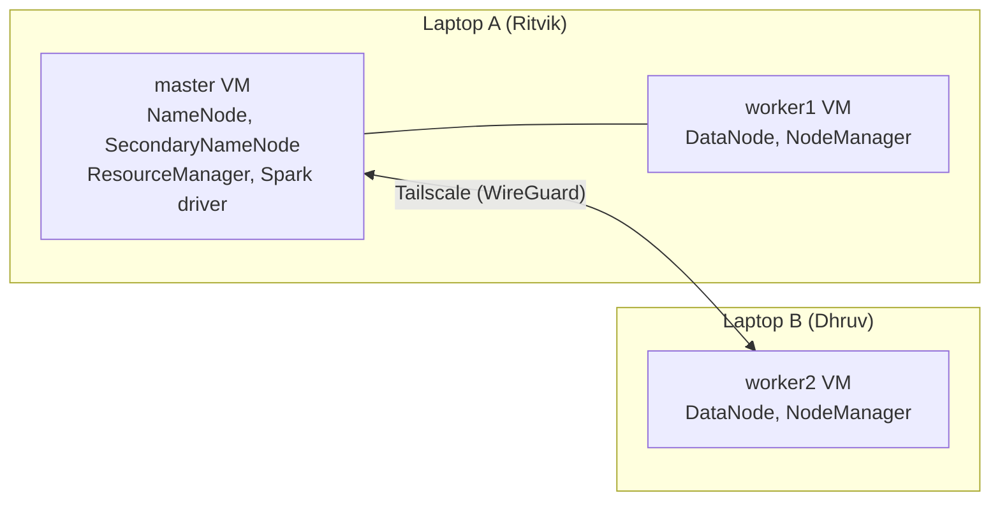

# Accident Severity Prediction and Hotspot Analysis of US Road Accidents Using Spark SQL and MLlib on a Hadoop Cluster

Big Data Analytics Mini Project | Department of Data Science Engineering, MIT Manipal
Course code: DSE 3125 | Semester: V | Section: DSE-A

## Team

| Name | Roll No. | Register No. |
|---|---|---|
| Ritvik Kar | 23 | 240968198 |
| Dhruv Abhijit Desai | 24 | 240968204 |
| Mithil S | 20 | 240968160 |

## 1. Overview

This project builds an end-to-end big data pipeline on a **multi-node Hadoop cluster that spans two laptops**. The US-Accidents dataset (7.7 million records) is stored in **HDFS**, processed with **Apache Spark running on YARN** (PySpark), and analysed with two Spark components:

- **Spark SQL / DataFrames:** ingestion, cleaning, feature engineering, hotspot and temporal analysis.
- **Spark MLlib:** accident severity classification (Logistic Regression and Random Forest) with class-imbalance handling.

An executor-scaling experiment measures how Spark job runtime changes with 1, 2 and 3 YARN executors.

> **Note on "severity".** In this dataset, severity (1 to 4) describes the **impact of the accident on traffic** (length of the delay it caused), not the injury severity of the people involved.

## 2. Problem statement and objectives

Identify spatial and temporal accident hotspots and the weather and road conditions most associated with severe (3 to 4) accidents, and build and compare MLlib models that predict severity from time, location, weather and road-feature attributes, with all processing executed on a multi-node Hadoop cluster using Spark on YARN.

| # | Objective | Status |
|---|---|---|
| 1 | Multi-node Hadoop cluster (1 NameNode/ResourceManager, 2 DataNodes/NodeManagers across two laptops) with the full dataset in HDFS | Done |
| 2 | Clean and transform with Spark DataFrames/SQL, documenting missing-value handling and engineered features | Done |
| 3 | Top accident-prone states and cities, peak hours and weather linked to severe accidents | Done |
| 4 | Train and compare at least two MLlib classifiers (accuracy, weighted F1, macro F1, confusion matrix) | Done |
| 5 | Measure runtime on YARN with different numbers of executors | Done |

## 3. Dataset

| Item | Value |
|---|---|
| Name | US-Accidents: A Countrywide Traffic Accident Dataset |
| Source | https://www.kaggle.com/datasets/sobhanmoosavi/us-accidents |
| Records | 7,728,394 (7,692,844 after cleaning) |
| Attributes | 46 (44 after cleaning and feature engineering) |
| Format / size | CSV, about 2.8 GB; 732 MB as Parquet |
| Coverage | Contiguous US, 2016 to March 2023 |
| License | CC BY-NC-SA 4.0 (research use, attribution, non-commercial) |

**The dataset is not included in this repository** (size and license). Download it from the link above and load it into HDFS (see section 6).

References for the dataset: Moosavi et al., "A Countrywide Traffic Accident Dataset", arXiv:1906.05409 (2019); Moosavi et al., "Accident Risk Prediction based on Heterogeneous Sparse Data: New Dataset and Insights", ACM SIGSPATIAL 2019.

## 4. Architecture and cluster configuration



| Component | Version / setting |
|---|---|
| Virtualisation | Oracle VirtualBox, 3 Ubuntu Server 22.04 VMs |
| VM resources | 2 vCPU, 3 GB RAM, 20 GB disk each (about 18 GB usable) |
| Java | OpenJDK 11 |
| Hadoop | 3.3.6 (HDFS replication factor 2) |
| Spark | 3.5.1 (prebuilt for Hadoop 3), PySpark, Python 3, client deploy mode on YARN |
| YARN | 2 NodeManagers, 2048 MB of container memory each (4 GB total) |
| Spark resources | driver 1 GB; executors 2 x (768 MB + 256 MB overhead), 1 core each; AM 512 MB (+256 MB) |
| Networking | VMs on different laptops are connected with Tailscale (free tier), which gives each VM a stable address on any network. Hostnames `master`, `worker1`, `worker2` resolve through `/etc/hosts`. |

Configuration files are in [`cluster/`](cluster/). YARN reports 8 vCores per node (the Hadoop default); the VMs actually have 2 vCPUs.

## 5. Repository structure

```
.
├── README.md
├── src/                 PySpark scripts (run with spark-submit on YARN)
│   ├── ingest.py          CSV in HDFS -> Parquet (schema, null counts, severity distribution)
│   ├── clean.py           cleaning + feature engineering -> accidents_clean
│   ├── analysis.py        Spark SQL hotspot / temporal / weather / road-feature analysis + charts
│   ├── ml.py              first MLlib run (baseline, Logistic Regression, Random Forest)
│   ├── ml2.py             MLlib experiments (feature sets x class-weighting schemes)
│   ├── scaling_job.py     workload used for the executor-scaling experiment
│   └── make_ml_charts.py  model comparison, confusion-matrix and feature-importance charts
├── scripts/run_scaling.sh runs scaling_job.py with 1, 2 and 3 executors
├── cluster/             Hadoop and Spark configuration files
├── results/             CSV outputs (tables, metrics, confusion matrices, scaling)
├── charts/              figures used in the report
├── outputs/             console output of each job (INFO/WARN lines removed)
└── screenshots/         HDFS UI, YARN UI, Spark UI, terminal evidence
```

## 6. How to reproduce

Prerequisite: a running HDFS + YARN cluster (`start-dfs.sh`, `start-yarn.sh`), Spark installed on the master with `spark.master yarn` (see `cluster/spark-defaults.conf`), and `python3-numpy`, `pandas`, `matplotlib` available on the master.

```bash
# 1. Put the dataset in HDFS (file name as downloaded from Kaggle)
hdfs dfs -mkdir -p /user/hadoop/accidents
hdfs dfs -put US_Accidents_March23.csv /user/hadoop/accidents/

# 2. Pipeline (each step reads the previous step's HDFS output)
spark-submit src/ingest.py        # -> hdfs:///user/hadoop/accidents_parquet
spark-submit src/clean.py         # -> hdfs:///user/hadoop/accidents_clean
spark-submit src/analysis.py      # -> results/*.csv, charts/*.png
spark-submit src/ml.py            # -> results/ml_metrics.csv
spark-submit src/ml2.py           # -> results/ml_experiments.csv
bash scripts/run_scaling.sh       # -> results/scaling.csv
python3 src/make_ml_charts.py     # -> charts/ml_*.png
```

Every Spark job runs on YARN and appears in the YARN UI (`:8088`) and the Spark UI (`:4040`, or `:18080` through the history server).

## 7. Methodology

1. **Ingestion (`ingest.py`).** Reads the 3 GB CSV from HDFS with schema inference, renames columns (Parquet cannot store spaces or brackets), reports null counts and the severity distribution, and writes Parquet. Parquet is about 4x smaller (732 MB) and much faster to scan.
2. **Cleaning and features (`clean.py`).**
   - Drops duplicate IDs and mostly-empty or free-text columns (`End_Lat`, `End_Lng`, `Wind_Chill_F`, `Description`, `Street`, and others).
   - Removes physically impossible weather values and implausible durations (kept: 0 to 1,440 minutes).
   - Imputes weather values with medians (`Precipitation_in` with 0) and categorical gaps with `Unknown`.
   - Adds `hour`, `day_of_week`, `month`, `year`, `is_weekend`, `season`, `duration_min`, and groups 100+ weather labels into 7 categories (`weather_group`).
   - Result: 7,728,394 to 7,692,844 rows (0.46% removed).
3. **Spark SQL analysis (`analysis.py`).** Aggregations by state, city, hour, weekday, weather group, season, year and road infrastructure, with the share of severe (3 to 4) accidents.
4. **MLlib models (`ml.py`, `ml2.py`).**
   - Stratified sample of about 1.5 million rows (same class mix), 80/20 train/test split.
   - Pipeline: `StringIndexer` -> `OneHotEncoder` -> `VectorAssembler`, then `LogisticRegression` (multinomial) and `RandomForestClassifier` (30 trees, depth 8).
   - Features: location, weather, time of day/week, 13 road-feature flags, state, weather group, sunrise/sunset, wind direction.
   - **Leakage control:** `duration_min` and `Distance_mi` are excluded (known only after the accident), and so is `year` (see limitations).
   - **Class imbalance:** instance weights, either inverse-frequency ("inverse") or its square root ("sqrt").
   - Variants with and without `month` and `season` to test sensitivity to data-collection timing.
5. **Scaling experiment (`scaling_job.py`).** Four aggregation queries on the clean data run with 1, 2 and 3 executors (2 runs each).

## 8. Results

### 8.1 Data and hotspots

- Severity classes are imbalanced: 1 = 67,355; 2 = 6,125,854; 3 = 1,298,929; 4 = 200,706 (about 80% severity 2).
- **States:** California has the most recorded accidents (1,739,361), then Florida (876,742) and Texas (582,423). Severe share varies widely: NY 23.2%, VA 22.9%, TX 21.9% vs OR 8.5%.
- **Cities:** Miami (185,639), Houston (169,340), Los Angeles (156,249). Dallas has the highest severe share among the top 10 (26.2%).
- **Hour:** accident counts peak at 07:00 to 08:00 and 16:00 to 17:00 (commutes); the severe share is highest at about 04:00 and 18:00 to 20:00 (about 21.5%) and lowest overnight (14.2% at 01:00).
- **Weekends** have fewer accidents but a higher severe share (Sat 21.1%, Sun 22.4% vs about 19% on weekdays).
- **Season:** winter has the most accidents (2.25M); summer has the highest severe share (23.1%).
- **Weather:** Rain/Storm 22.8% severe, Clear 16.9%, Fog/Haze 16.1%.
- **Road features:** junctions 26.8% severe (vs 18.9% without); crossings 7.0% (vs 21.1%).

Full tables are in `results/*.csv` and charts in `charts/`.

### 8.2 Classification (test set, `results/ml_experiments.csv`)

Feature set: without `month` and `season`. Test set: 308,143 rows.

| Model | Weights | Accuracy | Weighted F1 | Macro F1 | Balanced acc. | Recall Sev 1 / 2 / 3 / 4 |
|---|---|---|---|---|---|---|
| Baseline (always severity 2) | n/a | 0.798 | 0.708 | 0.222 | 0.250 | 0 / 1.00 / 0 / 0 |
| Logistic Regression | sqrt | 0.778 | **0.751** | **0.334** | 0.319 | 0.06 / 0.92 / 0.26 / 0.03 |
| Logistic Regression | inverse | 0.372 | 0.462 | 0.256 | **0.506** | 0.68 / 0.35 / 0.45 / 0.55 |
| Random Forest | sqrt | 0.799 | 0.713 | 0.237 | 0.258 | 0.02 / 1.00 / 0.01 / 0.00 |
| Random Forest | inverse | 0.287 | 0.351 | 0.218 | 0.510 | 0.71 / 0.22 / 0.51 / 0.59 |

Findings:

- Logistic Regression with sqrt weights is the best all-round model: it beats the baseline on weighted F1 (0.751 vs 0.708) and macro F1 (0.334 vs 0.222).
- Weighting is a precision/recall trade-off. Inverse weights find more rare severe cases (recall for severity 4 up to 0.59) but with very low precision, so accuracy drops; sqrt weights keep accuracy and precision but find few severity 1 and 4 cases.
- Random Forest (30 trees, depth 8, limited by the 1 GB executors) did not outperform Logistic Regression and takes about 6x longer to train (about 127 s vs about 19 s).
- Removing `month` and `season` leaves weighted F1 unchanged (0.751 vs 0.751), so the models do not rely on those time features.
- Random Forest feature importance (inverse weights, no month/season): `Traffic_Signal` 0.164, `Pressure_in` 0.092, `Crossing` 0.087, `Temperature_F` 0.085, `Start_Lat` 0.079, `Start_Lng` 0.068, `hour` 0.061.
- Overall predictive power is modest: weather, time and road features explain only part of the traffic impact of an accident.

### 8.3 Executor scaling (`results/scaling.csv`)

| Executors | Run 1 (s) | Run 2 (s) | Best (s) | Speed-up vs 1 |
|---|---|---|---|---|
| 1 | 35.3 | 28.7 | 28.7 | 1.00x |
| 2 | 19.7 | 18.8 | 18.8 | 1.53x |
| 3 | 23.4 | 23.1 | 23.1 | 1.24x |

Going from 1 to 2 executors (one per worker) cuts runtime by about 35%. A third executor is slower: with two 2-vCPU worker VMs, two executors share one VM, the job lasts only about 20 seconds so fixed overheads (scheduling, JVM start, shuffle over Tailscale) dominate, and the cluster is memory-bound (4 GB of container memory).
`[TODO: state whether these runs used the worker2 VM on Laptop A or Dhruv's Laptop B]`

### 8.4 Evidence (all files in [`screenshots/`](screenshots/))

## 9. Limitations and future work

- **Severity measures traffic impact, not injury.** Conclusions concern delays, not safety outcomes.
- **Counts are not rates.** There is no traffic-volume data, so busy states naturally record more accidents.
- **The yearly trend is a data-collection artefact.** The severe share falls from about 35% (2016 to 2018) to 2.8% (2023) while recorded accidents grow, which reflects how and where reports were collected. `year` is therefore excluded from the models. 2016 and 2023 are partial years.
- **Modest model performance and compute limits.** Models use a 1.5M-row stratified sample, small executors (1 GB), and shallow trees. Future work: the full dataset, larger executors or more nodes, gradient-boosted trees, a time-based train/test split, and external data (traffic volume, speed limits).
- **Scaling results come from a small cluster** (2 worker VMs on two laptops over a VPN link) and a short workload, so they show the trend rather than a precise benchmark.
- **Network:** Tailscale was used so VMs on separate laptops could communicate across networks that block device-to-device traffic.

## 10. Team contributions

`[TODO: fill in; each member should be able to explain the whole pipeline in the viva]`

| Member | Contribution |
|---|---|
| Ritvik Kar | `[e.g. cluster setup, Spark on YARN, ingestion and cleaning, scaling experiment]` |
| Dhruv Abhijit Desai | `[e.g. worker2 node, Spark SQL exploration and hotspot analysis, charts]` |
| Mithil S | `[e.g. MLlib models and evaluation, report sections]` |

## 11. References and acknowledgements

1. S. Moosavi, M. H. Samavatian, S. Parthasarathy, R. Ramnath, "A Countrywide Traffic Accident Dataset", arXiv:1906.05409, 2019.
2. S. Moosavi et al., "Accident Risk Prediction based on Heterogeneous Sparse Data: New Dataset and Insights", ACM SIGSPATIAL, 2019.
3. Dataset page: https://www.kaggle.com/datasets/sobhanmoosavi/us-accidents
4. Apache Hadoop 3.3.6 documentation (cluster setup, YARN): https://hadoop.apache.org/docs/r3.3.6/
5. Apache Spark 3.5.1 documentation (Spark on YARN, SQL, MLlib): https://spark.apache.org/docs/3.5.1/
6. Tailscale documentation: https://tailscale.com/kb

Code is released under the MIT license (`[add a LICENSE file]`). The dataset keeps its original CC BY-NC-SA 4.0 license.
